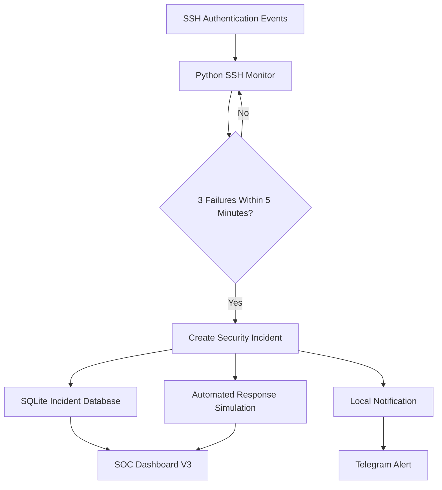

# Automated Home Lab SOC with SIEM & SOAR Integration

A Python-based Home Lab Security Operations Center (SOC) that detects SSH brute-force attacks, manages security incidents, simulates automated response decisions, and sends real-time Telegram alerts.

**Project Type:** Final Year B.Tech Computer Science and Engineering Major Project

## Overview

This project demonstrates a lightweight SOC environment built using Python and Ubuntu Linux.

It monitors SSH authentication events, detects repeated failed login attempts, stores security incidents in an SQLite database, and records automated response decisions.

A local web dashboard provides incident visibility and management.

## Key Features

- SSH brute-force attack detection.
- Detection threshold of 3 failed login attempts within 5 minutes.
- Real-time SSH event monitoring.
- SQLite-based incident storage.
- Duplicate incident protection.
- Incident status management:
  - Open
  - Investigating
  - Resolved
- Automated response simulation.
- Protected IP address checks.
- Local JSON notification logging.
- Real-time Telegram security alerts.
- Web-based SOC Dashboard V3.
- Response action history.
- SSH detector unit tests.

## Architecture



## Technology Stack

| Technology | Purpose |
|---|---|
| Python | Detection and automation |
| Ubuntu Linux | SOC lab environment |
| SQLite | Incident database |
| HTML and CSS | Dashboard interface |
| Telegram Bot API | Security notifications |
| JSON / JSONL | Event and response records |
| Git and GitHub | Version control |
| VirtualBox | Virtual lab environment |
| VS Code | Development |

## Project Structure

```text
automated-home-lab-soc/
├── dashboard.py
├── dashboard_v2.py
├── dashboard_v3.py
├── main.py
├── integrations/
│   ├── auto_response.py
│   ├── incident_store.py
│   ├── journal_adapter.py
│   ├── live_monitor.py
│   ├── notifier.py
│   └── ssh_detector.py
├── response/
│   └── simulate_response.py
├── samples/
├── tests/
│   └── test_ssh_detector.py
├── docs/
└── README.md
```

## How It Works

1. The monitoring component receives SSH authentication events.
2. The detector identifies repeated failed login attempts.
3. When the configured threshold is reached, a security incident is created.
4. The incident is stored in SQLite.
5. The response component records a simulated response decision.
6. A local notification is saved.
7. A Telegram alert is sent if credentials are configured.
8. The dashboard displays incidents and response history.

## Installation

### Requirements

- Ubuntu Linux
- Python 3
- Git

### 1. Clone the repository

```bash
git clone https://github.com/YOUR-GITHUB-USERNAME/automated-home-lab-soc.git
cd automated-home-lab-soc
```

Replace `YOUR-GITHUB-USERNAME` with your GitHub username.

### 2. Create a virtual environment

```bash
python3 -m venv .venv
source .venv/bin/activate
```

### 3. Initialize the incident database

```bash
python integrations/incident_store.py init
```

### 4. Start the dashboard

```bash
python dashboard_v3.py
```

Open this address in your browser:

`http://127.0.0.1:8766`

## Testing

Run the SSH detector unit tests:

```bash
python -m unittest discover -s tests -v
```

To process the included SSH event sample:

```bash
cd integrations
python live_monitor.py < ../samples/ssh_stream_test.jsonl
```

## Telegram Alert Configuration

Telegram notifications are optional.

1. Create a Telegram bot using BotFather.
2. Obtain your bot token and chat ID.
3. Create a private configuration directory:

```bash
mkdir -p ~/.config/automated-soc
chmod 700 ~/.config/automated-soc
```

4. Create the credentials file:

```bash
nano ~/.config/automated-soc/telegram.env
```

Add your own credentials:

```text
TELEGRAM_BOT_TOKEN=YOUR_BOT_TOKEN
TELEGRAM_CHAT_ID=YOUR_CHAT_ID
```

5. Save the file and protect it:

```bash
chmod 600 ~/.config/automated-soc/telegram.env
```

**Security:** Never upload your Telegram bot token or credentials to GitHub.

## Automated Response Safety

The current response engine operates in **simulation mode**.

It records decisions such as `SIMULATED_BLOCK` in the response history. It does not modify firewall rules or actually block network traffic.

## Future Enhancements

- Wazuh SIEM integration.
- Shuffle SOAR workflow integration.
- TheHive case management integration.
- Additional attack detection rules.
- Enhanced dashboard analytics.

These are planned enhancements, not completed integrations.

## Disclaimer

This is an educational Home Lab SOC prototype. Only use systems and logs you own or are authorized to test. Automated response currently operates in simulation mode.

## Author

Final Year B.Tech Computer Science and Engineering Student

**Project:** Automated Home Lab SOC with SIEM & SOAR Integration